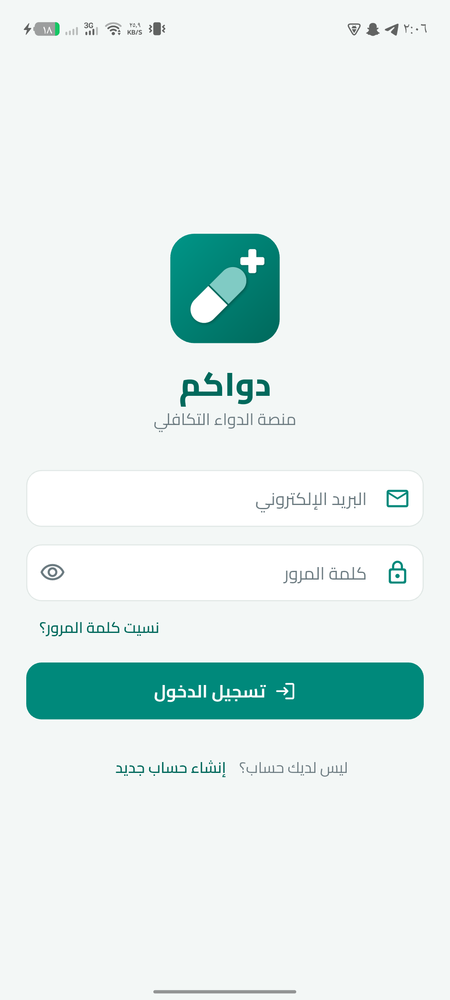

<div align="center">


# دواكم — Dawacom

**منصة تكافلية للتبرع بالأدوية الفائضة وإيصالها مجاناً لمن يحتاجها عبر صيدليات موثوقة**

*A community platform for donating surplus medicine and delivering it, free of charge, to people in need through verified pharmacies.*


</div>

---

## الفكرة

كثير من البيوت فيها أدوية سليمة وفائضة عن الحاجة، وكثير من الناس لا يستطيعون شراء دوائهم.
**دواكم** يربط الطرفين عبر صيدلاني مدقّق يتحقق من سلامة الدواء قبل عرضه:

```
المتبرع يضيف الدواء (مع صورة)  →  الصيدلاني يدقّق ويوافق  →  المحتاج يحجزه  →  يستلمه من الصيدلية
```

## المميزات

| | الميزة | التفاصيل |
|---|---|---|
| 📸 | **تصوير الدواء** | التقاط صورة من الكاميرا أو المعرض، تُضغط تلقائياً وتُعرض للصيدلاني والمحتاج مع إمكانية التكبير |
| 📅 | **تاريخ صلاحية ذكي** | منتقي تاريخ عربي، منع التبرع بدواء يتبقى على انتهائه أقل من 30 يوماً، وتنبيه ملوّن للقريب من الانتهاء |
| 🔍 | **بحث وفلترة** | بحث فوري بالاسم، فلترة حسب المحافظة والتصنيف (13 تصنيفاً دوائياً) |
| 👤 | **ملف شخصي** | اسم ورقم هاتف ومحافظة قابلة للتعديل، وإحصائيات التبرعات والطلبات |
| 📋 | **شاشة تفاصيل** | كل معلومات الدواء، ملاحظات المتبرع، وبيانات التواصل للصيدلاني مع زر اتصال مباشر |
| 🔐 | **مصادقة كاملة** | تسجيل دخول وإنشاء حساب واستعادة كلمة المرور، مع رسائل خطأ عربية واضحة |
| 💊 | **لوحة الصيدلاني** | مراجعة التبرعات الجديدة بالصورة ورقم المتبرع، قبول أو رفض بضغطة |
| ⚡ | **تحديث لحظي** | كل القوائم تعتمد على Firestore Streams فتتحدث فوراً دون إعادة تحميل |
| 🇸🇾 | **عربي بالكامل** | واجهة من اليمين لليسار، خط Cairo، أسماء الأشهر الشامية، صياغة عربية صحيحة للأعداد |

## لقطات الشاشة

<!-- أضف لقطات الشاشة هنا بعد التشغيل -->
| تسجيل الدخول | الأدوية المتاحة | إضافة تبرع | تفاصيل الدواء |
|:---:|:---:|:---:|:---:|
|  |  |  |  |

## التقنيات

- **Flutter 3.44** / Dart 3.10 — Material 3
- **Firebase Auth** — المصادقة بالبريد الإلكتروني
- **Cloud Firestore** — قاعدة البيانات اللحظية (الصور تُخزَّن مضغوطة Base64 داخل المستند، دون الحاجة لـ Firebase Storage أو خطة مدفوعة)
- **image_picker** — الكاميرا والمعرض مع ضغط تلقائي
- **url_launcher** — الاتصال المباشر بالمتبرع

## هيكلية المشروع

```
lib/
├── main.dart                     # نقطة البداية، الثيم، اللغة العربية
├── core/
│   ├── app_theme.dart            # الألوان والثيم الموحد
│   ├── constants.dart            # المحافظات، التصنيفات، الحدود
│   ├── formats.dart              # تنسيق التواريخ والأعداد بالعربية
│   └── utils.dart                # الأخطاء، الرسائل، التحقق من المدخلات
├── models/
│   ├── app_user.dart             # نموذج المستخدم والأدوار
│   └── medicine.dart             # نموذج الدواء وحالاته
├── services/
│   ├── auth_service.dart         # Firebase Auth + ترجمة الأخطاء
│   ├── user_service.dart         # مجموعة users
│   ├── medicine_service.dart     # مجموعة medicines (مع معاملة الحجز)
│   └── image_service.dart        # التقاط الصور وضغطها
├── widgets/                      # مكونات مشتركة (بطاقة الدواء، الشارات، الحالات الفارغة...)
└── screens/
    ├── auth/                     # البوابة، الدخول، التسجيل، استعادة كلمة المرور
    ├── user/                     # واجهة المتبرع/المحتاج وتبويباتها
    ├── medicine/                 # إضافة دواء، تفاصيل الدواء
    ├── pharmacist/               # لوحة الصيدلاني
    └── profile/                  # الملف الشخصي
```

## بنية البيانات (Firestore)

**`users/{uid}`**
```json
{ "name": "...", "email": "...", "phone": "09...", "city": "دمشق", "role": "user | pharmacist", "createdAt": Timestamp }
```

**`medicines/{id}`**
```json
{
  "name": "...", "category": "...", "quantity": 2,
  "expiryDate": Timestamp, "pharmacy": "...", "city": "...", "notes": "...",
  "imageBase64": "...",
  "status": "pending | approved | requested | rejected",
  "donorId": "...", "donorName": "...", "donorPhone": "...",
  "recipientId": null, "recipientName": null, "recipientPhone": null,
  "createdAt": Timestamp, "reviewedAt": Timestamp, "requestedAt": Timestamp
}
```

دورة حالة الدواء:

```
pending ──(صيدلاني)──► approved ──(محتاج)──► requested
   └──────(صيدلاني)──► rejected
```

## التشغيل محلياً

```bash
git clone https://github.com/Tareq-Bassam-Bakr/dawacom.git
cd dawacom
flutter pub get
flutter run
```

> المشروع مرتبط بمشروع Firebase جاهز (`dawacom-39565`). لربطه بمشروعك الخاص:
> ```bash
> dart pub global activate flutterfire_cli
> flutterfire configure
> ```

### قواعد الأمان

قواعد Firestore موجودة في [`firestore.rules`](firestore.rules) وتضمن أن:
- المستخدم يعدّل ملفه فقط ولا يستطيع تغيير دوره بعد التسجيل.
- المتبرع ينشئ الدواء باسمه وبحالة `pending` فقط.
- الصيدلاني وحده يقبل أو يرفض.
- المحتاج يحجز الدواء المتاح باسمه فقط، ولا يستطيع حجز دواء تبرع به هو.

للنشر:
```bash
firebase deploy --only firestore:rules
```

### بناء نسخة الإصدار

```bash
flutter build apk --release
```

## الاختبارات

```bash
flutter test
```

## خارطة الطريق

- [ ] إشعارات فورية عند قبول التبرع أو حجزه
- [ ] تأكيد التسليم من الصيدلاني وسجل كامل للعمليات
- [ ] إلغاء الطلب أو التبرع من المستخدم
- [ ] التحقق من حسابات الصيادلة برقم الترخيص
- [ ] الوضع الليلي

## الترخيص

MIT — انظر [LICENSE](LICENSE).

---

<div align="center">صُنع بـ ❤️ ليصل الدواء لمن يحتاجه</div>
