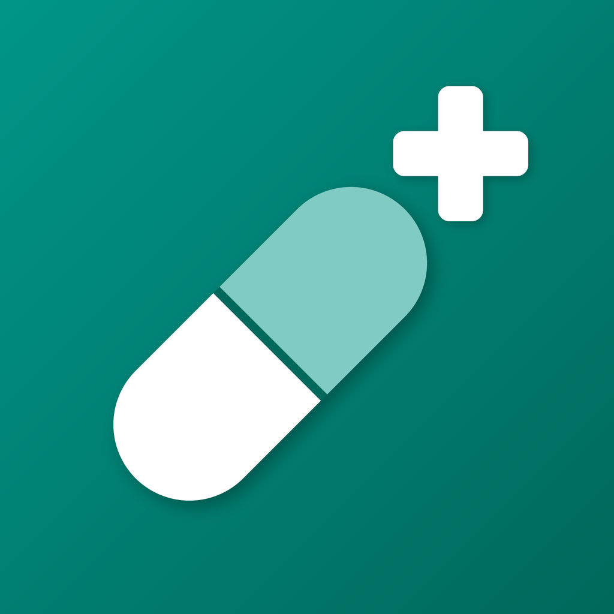
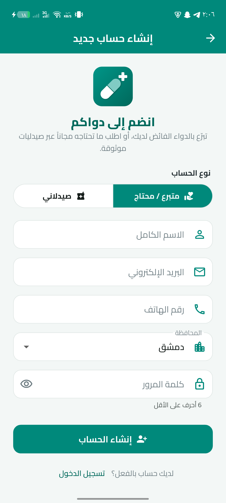
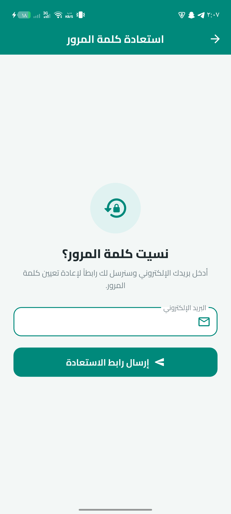

<div align="center">



# دواكم — Dawacom

**منصة تكافلية للتبرع بالأدوية الفائضة وإيصالها مجاناً لمن يحتاجها عبر صيدليات موثوقة**

*A community platform for donating surplus medicine and delivering it, free of charge, to people in need through verified pharmacies.*


</div>

---

## الفكرة

كثير من البيوت فيها أدوية سليمة وفائضة عن الحاجة، وكثير من الناس لا يستطيعون شراء دوائهم.
**دواكم** يربط الطرفين عبر صيدليات موثّقة تفحص الدواء وتحفظه وتسلّمه، على نهج برامج إعادة توزيع الأدوية المرخّصة عالمياً (مثل SIRUM في الولايات المتحدة وGIVMED في اليونان):

```
المتبرع يختار صيدلية في محافظته  →  الصيدلي يفحص الدواء ويقبله  →  المحتاج يحجزه  →  يستلمه من الصيدلية خلال 3 أيام
```

## المميزات

### للمتبرع والمحتاج

| الميزة | التفاصيل |
|---|---|
| **تصوير الدواء** | التقاط صورة من الكاميرا أو المعرض، تُضغط تلقائياً وتُعرض مع إمكانية التكبير |
| **اختيار الصيدلية** | المتبرع يختار صيدلية من محافظته، مع شارة "موثّقة" أو "قيد التوثيق" |
| **حد صلاحية 6 أشهر** | لا يُقبل دواء يتبقى على انتهائه أقل من 6 أشهر، والمنتهي يُخفى تلقائياً عن المحتاجين |
| **بحث وفلترة** | بحث فوري بالاسم، فلترة حسب المحافظة والتصنيف (13 تصنيفاً دوائياً) |
| **الحجز والوصفة** | حجز لمدة 3 أيام، مع إرفاق صورة الوصفة للأدوية التي تُصرف بوصفة |
| **سبب الرفض** | يرى المتبرع سبب رفض تبرعه وملاحظة الصيدلي بدل رسالة عامة |
| **مصادقة كاملة** | تسجيل دخول وإنشاء حساب واستعادة كلمة المرور، مع رسائل خطأ عربية واضحة |

### للصيدلي

| الميزة | التفاصيل |
|---|---|
| **توثيق برقم الترخيص** | حساب الصيدلي يبقى "قيد التوثيق" حتى تتحقق إدارة المنصة من ترخيصه |
| **ملف الصيدلية** | الاسم والعنوان وساعات الدوام والهاتف، تظهر للمحتاج كمكان استلام |
| **مراجعة التبرعات** | قبول برسالة تأكيد، أو رفض بسبب إلزامي من قائمة جاهزة مع ملاحظة |
| **تصحيح البيانات** | تعديل الاسم والتصنيف والكمية والصلاحية وتسجيل رقم التشغيلة (Batch) قبل القبول |
| **بانتظار الاستلام** | الحجوزات مع اسم المحتاج وهاتفه، تمييز من تجاوز المهلة، وإلغاء الحجز |
| **الوصفات الطبية** | تعليم الدواء "يحتاج وصفة"، وعرض الوصفة المرفقة قبل التسليم |
| **تنبيهات الصلاحية** | الأدوية المتاحة التي يتبقى على انتهائها شهران أو أقل |
| **التبرعات القديمة** | تظهر لصيادلة محافظتها، مع فلتر لعرض كل المحافظات |

## لقطات الشاشة

| تسجيل الدخول | إنشاء حساب | استعادة كلمة المرور |
|:---:|:---:|:---:|
|  |  |  |

## التقنيات

- **Flutter 3.44** / Dart 3.10 — Material 3
- **Firebase Auth** — المصادقة بالبريد الإلكتروني
- **Cloud Firestore** — قاعدة البيانات اللحظية (الصور تُخزَّن مضغوطة Base64 داخل المستند، دون الحاجة لـ Firebase Storage أو خطة مدفوعة)
- **image_picker** — الكاميرا والمعرض مع ضغط تلقائي
- **url_launcher** — الاتصال المباشر بالمتبرع والمحتاج والصيدلية

## هيكلية المشروع

```
lib/
├── main.dart                     # نقطة البداية، الثيم، اللغة العربية
├── core/
│   ├── app_theme.dart            # الألوان والثيم الموحد
│   ├── constants.dart            # المحافظات، التصنيفات، الحدود
│   ├── formats.dart              # تنسيق التواريخ والأعداد بالعربية
│   └── utils.dart                # الأخطاء، الرسائل، التحقق من المدخلات
├── models/
│   ├── app_user.dart             # نموذج المستخدم والأدوار
│   └── medicine.dart             # نموذج الدواء وحالاته
├── services/
│   ├── auth_service.dart         # Firebase Auth + ترجمة الأخطاء
│   ├── user_service.dart         # مجموعة users
│   ├── medicine_service.dart     # مجموعة medicines (مع معاملة الحجز)
│   └── image_service.dart        # التقاط الصور وضغطها
├── widgets/                      # مكونات مشتركة (بطاقة الدواء، الشارات، الحالات الفارغة...)
└── screens/
    ├── auth/                     # البوابة، الدخول، التسجيل، استعادة كلمة المرور
    ├── user/                     # واجهة المتبرع/المحتاج وتبويباتها
    ├── medicine/                 # إضافة دواء، تفاصيل الدواء
    ├── pharmacist/               # لوحة الصيدلي (المراجعة، الاستلام، الصلاحية)
    └── profile/                  # الملف الشخصي
```

## بنية البيانات (Firestore)

**`users/{uid}`**
```json
{
  "name": "...", "email": "...", "phone": "09...", "city": "دمشق",
  "role": "user | pharmacist", "verified": false,
  "licenseNumber": "...", "pharmacyName": "...", "pharmacyAddress": "...", "pharmacyHours": "...",
  "createdAt": Timestamp
}
```

**`medicines/{id}`**
```json
{
  "name": "...", "category": "...", "quantity": 2, "expiryDate": Timestamp,
  "batchNumber": "...", "requiresPrescription": false, "notes": "...", "imageBase64": "...",
  "pharmacyId": "...", "pharmacy": "...", "pharmacyAddress": "...", "pharmacyPhone": "...", "city": "...",
  "status": "pending | approved | requested | rejected",
  "rejectionReason": "...", "rejectionNote": "...", "reviewerName": "...",
  "donorId": "...", "donorName": "...", "donorPhone": "...",
  "recipientId": null, "recipientName": null, "recipientPhone": null, "hasPrescription": false,
  "createdAt": Timestamp, "reviewedAt": Timestamp, "requestedAt": Timestamp
}
```

**`prescriptions/{medicineId}_{recipientId}`** (خاصة: لا يقرؤها إلا المحتاج وصيدليته)
```json
{ "medicineId": "...", "recipientId": "...", "pharmacyId": "...", "imageBase64": "...", "createdAt": Timestamp }
```

دورة حالة الدواء:

```
pending ──(صيدلي موثّق)──► approved ──(محتاج)──► requested
   └──────(صيدلي موثّق + سبب)──► rejected        └──(إلغاء الحجز)──► approved
```

## التشغيل محلياً

```bash
git clone https://github.com/Tareq-Bassam-Bakr/dawacom.git
cd dawacom
flutter pub get
flutter run
```

> المشروع مرتبط بمشروع Firebase جاهز (`dawacom-39565`). لربطه بمشروعك الخاص:
> ```bash
> dart pub global activate flutterfire_cli
> flutterfire configure
> ```

### قواعد الأمان

قواعد Firestore موجودة في [`firestore.rules`](firestore.rules) وتضمن أن:
- المستخدم يعدّل ملفه فقط، ولا يستطيع تغيير دوره أو توثيق نفسه، ولا يتغير رقم الترخيص بعد التوثيق.
- المتبرع ينشئ الدواء باسمه وبحالة `pending` فقط، ولصيدلية مسجّلة.
- الصيدلي الموثّق وحده يقبل أو يرفض أو يلغي الحجز، وفقط لأدوية صيدليته، والرفض يتطلب سبباً.
- المحتاج يحجز الدواء المتاح باسمه فقط، ولا يستطيع حجز دواء تبرع به هو.
- الوصفات الطبية لا يقرؤها إلا صاحبها والصيدلي المسؤول.

للنشر:
```bash
firebase deploy --only firestore:rules
```

### توثيق الصيادلة

يسجّل الصيدلي حسابه من التطبيق برقم ترخيص مزاولة المهنة، فيبقى "قيد التوثيق". بعد التحقق من الرقم لدى نقابة الصيادلة:

1. افتح [Firebase Console](https://console.firebase.google.com/project/dawacom-39565/firestore/data/~2Fusers) ثم Firestore Database ثم المجموعة `users`.
2. اختر مستند الصيدلي، وتأكد من `role` = `pharmacist` ومن `licenseNumber`.
3. غيّر الحقل `verified` إلى `true` (من النوع boolean). إن لم يكن موجوداً أضفه بهذا الاسم والنوع.

يظهر التوثيق في التطبيق فوراً دون إعادة تشغيله. لإلغاء التوثيق أعد القيمة إلى `false`.

### بناء نسخة الإصدار

```bash
flutter build apk --release
```

## الاختبارات

```bash
flutter test
```

## خارطة الطريق

- [ ] إشعارات فورية عند قبول التبرع أو حجزه
- [ ] تأكيد التسليم برمز استلام وسجل كامل للعمليات
- [ ] لوحة إحصائيات للصيدلي
- [ ] إلغاء الطلب أو التبرع من المستخدم
- [ ] شاشة إدارة داخل التطبيق لتوثيق الصيادلة
- [ ] الوضع الليلي

## الترخيص

MIT — انظر [LICENSE](LICENSE).

---

<div align="center">صُنع بـ ❤️ ليصل الدواء لمن يحتاجه</div>
